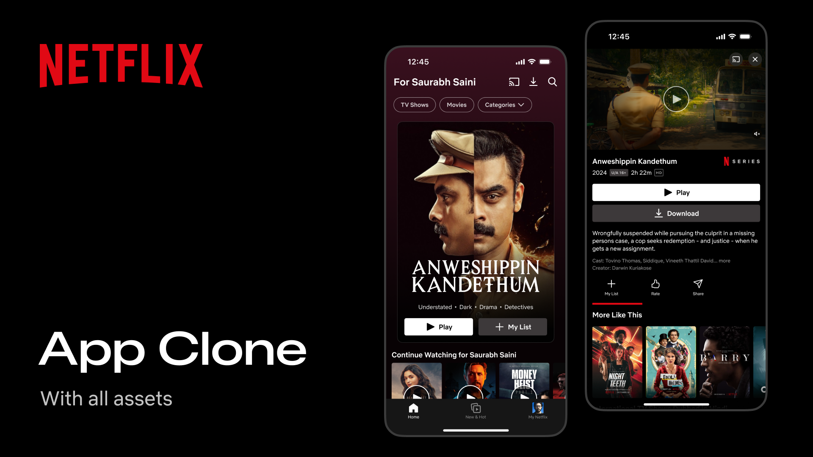

<div align="center">
  
</div>

<h1 align="center">🎬 Clone Netflix</h1>

<p align="center">
  Clon de la interfaz de Netflix construido con React Native, Expo Router y NativeWind.
</p>

<p align="center">
  
  
  
  
</p>

---

## ✨ Features

Home con carruseles, pantalla de detalles, botones reutilizables (Play/Download), animaciones de entrada y press feedback con `react-native-ease`, navegación por tabs, y splash screen adaptado a modo oscuro/claro.

## 🛠️ Stack

Expo 54 · React Native 0.81 · Expo Router · NativeWind · TypeScript · Zustand · react-native-ease · react-native-svg

## 🚀 Instalación

```bash
git clone <https://github.com/smithmoreno12/clone-netflix>
cd clone-netflix
npm install
```

## ▶️ Uso

```bash
npm run start      # Dev client
npm run ios
npm run android
npm run web
```

## 📦 Build

```bash
npm run build:dev
npm run build:preview
npm run build:prod
```

## ⚠️ Disclaimer

Proyecto educativo / de portafolio, sin fines comerciales. Netflix y su marca son propiedad de Netflix, Inc. Sin afiliación.
